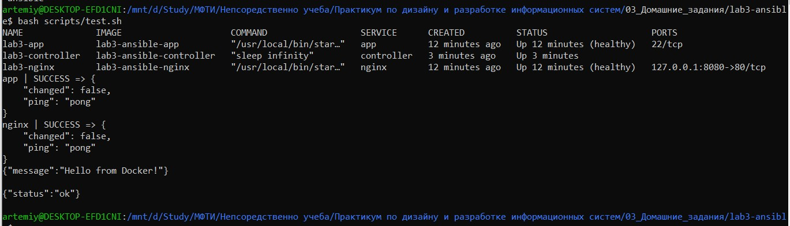
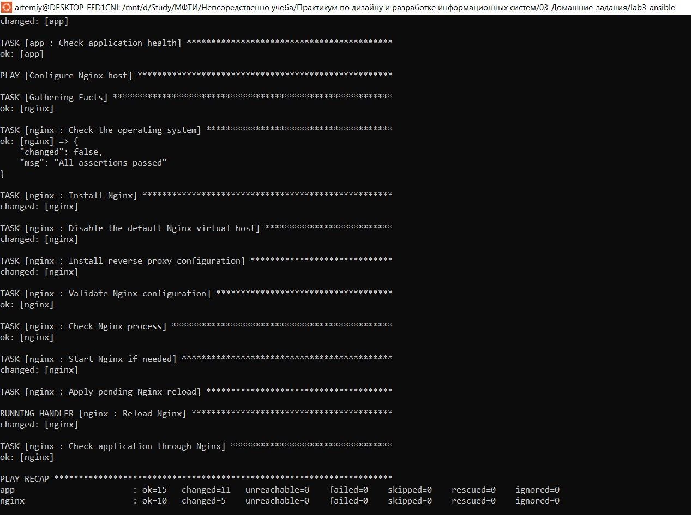
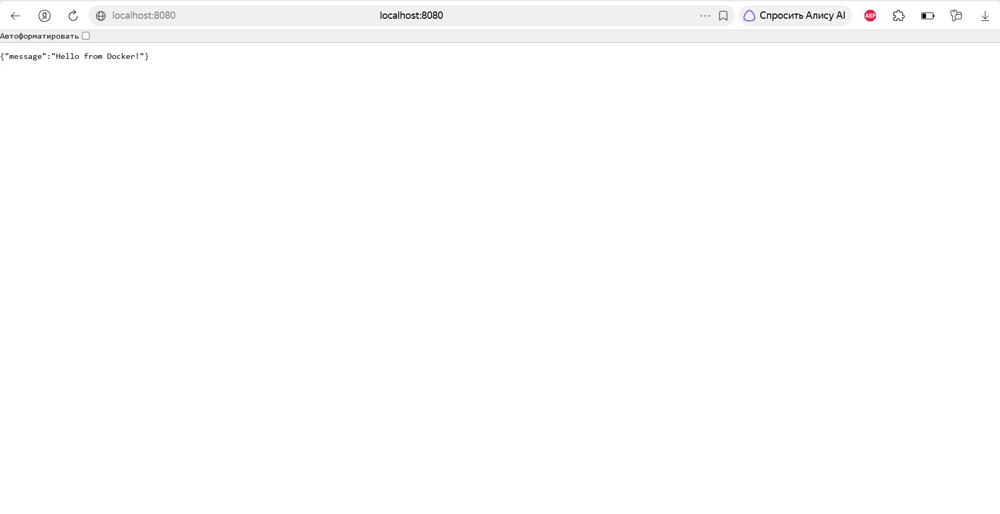

# Лабораторная работа №3 — Ansible

В этой работе Ansible устанавливает Nginx и разворачивает Flask-приложение в Docker-контейнерах. Приложение взято из [лабораторной №2](https://github.com/MegatronJunior/lab2-docker/tree/feature/lab2-docker/app), его исходники находятся в папке `app/`.

## Как устроен стенд

| Контейнер | Назначение |
| --- | --- |
| `controller` | Запускает Ansible и подключается к остальным контейнерам по SSH |
| `nginx` | Принимает HTTP-запросы и передаёт их приложению |
| `app` | Запускает Flask-приложение через Gunicorn |

Все три контейнера находятся в сети `lab3-net`. Приложение доступно через Nginx по адресу http://localhost:8080.

Целевые образы собраны на Ubuntu 24.04. В них заранее установлены SSH-сервер и Python 3 для работы Ansible. Nginx, зависимости и само приложение устанавливаются плейбуком.

## Запуск

Понадобятся Docker с поддержкой `docker compose`, а также `bash`, `ssh-keygen`, `tar` и `curl`. Под Windows команды нужно выполнять в Ubuntu WSL с настроенным доступом к Docker.

Из корня проекта:

```bash
bash scripts/up.sh
bash scripts/deploy.sh
bash scripts/test.sh
```

`up.sh` создаёт SSH-ключи, собирает образы и поднимает контейнеры. Ключи хранятся в `.ssh/` и исключены из Git.

`deploy.sh` собирает архив из папки `app/` и запускает плейбук внутри `controller`. Роль `app` проверяет ОС, устанавливает зависимости, распаковывает приложение и настраивает его запуск. Роль `nginx` устанавливает сервер, настраивает проксирование и проверяет конфигурацию.

Для запуска приложения Ansible создаёт `/opt/lab3-app/start.sh` из шаблона `ansible/roles/app/templates/start-app.sh.j2`. Скрипт запускает Gunicorn из виртуального окружения. Supervisor следит за процессом и перезапускает его при падении.

`test.sh` выводит состояние контейнеров, проверяет подключение Ansible к обоим узлам и отправляет запросы к приложению через Nginx.

## Проверка

Открыть http://localhost:8080 в браузере или выполнить:

```bash
curl -i http://localhost:8080/
curl -i http://localhost:8080/health
```

Оба запроса должны вернуть `200 OK`. Ответ на `/`:

```json
{"message":"Hello from Docker!"}
```

Ответ на `/health`:

```json
{"status":"ok"}
```

Дополнительные команды для проверки стенда:

```bash
docker compose ps
docker network inspect lab3-net
docker compose exec -T controller ansible all -m ping
docker compose exec -T controller ansible-playbook --syntax-check site.yml
docker compose exec -T app supervisorctl status
docker compose exec -T nginx nginx -t
```

После изменения исходников приложение можно обновить повторным запуском `bash scripts/deploy.sh`.

## Файлы проекта

| Путь | Содержимое |
| --- | --- |
| `ansible/site.yml` | Основной плейбук |
| `ansible/inventory.ini` | Узлы для подключения по SSH |
| `ansible/group_vars/all.yml` | Общие переменные |
| `ansible/roles/app/` | Установка и запуск приложения |
| `ansible/roles/nginx/` | Установка и настройка Nginx |
| `app/` | Исходники приложения и Python-зависимости |
| `docker/` | Dockerfile и скрипт запуска SSH-сервера |
| `scripts/` | Скрипты сборки, развёртывания и проверки |
| `compose.yaml` | Контейнеры, сеть и проброс порта |
| `screenshots/` | Скриншоты работающего стенда |

## Скриншоты

Состояние контейнеров, подключение Ansible и ответы приложения:



Результат выполнения плейбука:



Приложение в браузере:



## Остановка

```bash
docker compose down
```

Для повторного развёртывания на чистых контейнерах после остановки нужно выполнить команды из раздела «Запуск».
